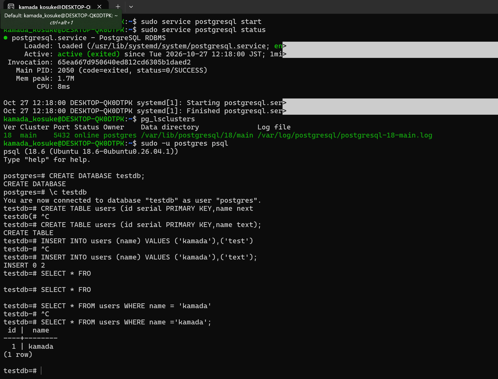
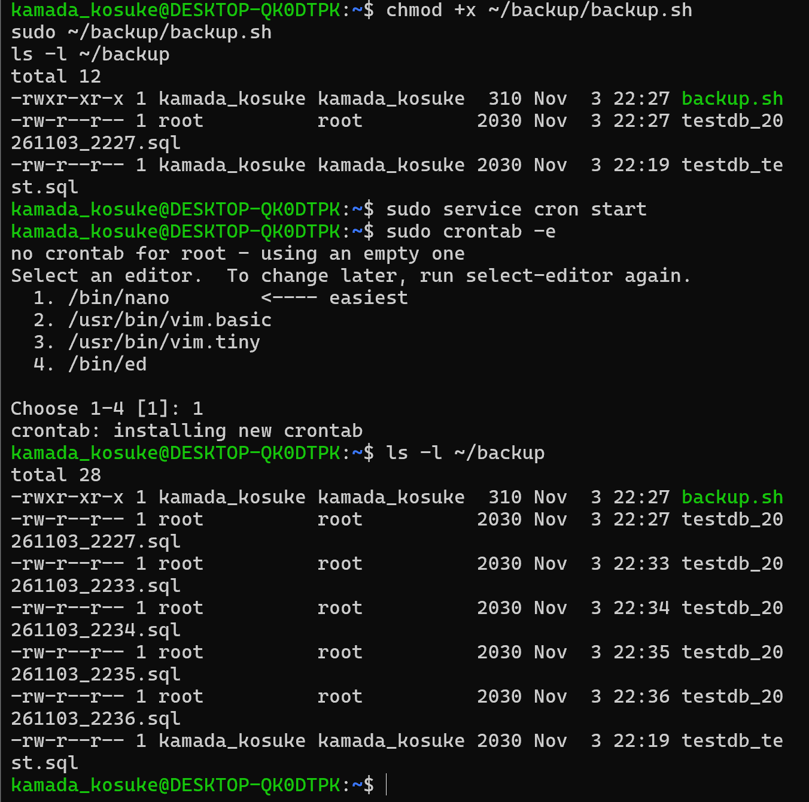

# Linux環境でのWebサーバ・DB構築（WSL / Ubuntu）

## 目的
保守運用の経験をもとに、設計・構築へ進むための学習として、**Linux上にWebサーバとDBが動く環境を自分で構築**し、構築の流れを一通り身につけることを目的としています。
今後は同じ構成を **AWS（EC2・RDS）** でも構築する予定です。

## 環境
| 項目 | 内容 |
|---|---|
| OS | Windows + WSL（Ubuntu） |
| Webサーバ | Apache2 |
| DB | PostgreSQL 18 |

## 構成
```
Windows
 └─ WSL（Ubuntu）
     ├─ Apache2（Webサーバ）… http://localhost:8080 で表示（ポートを80から変更）
     ├─ PostgreSQL 18（DB） … ポート5432で稼働
     └─ cron + シェルスクリプト … 毎日3時にDBを自動バックアップ
```

## 手順

### 1. WSL（Ubuntu）の導入
```powershell
wsl --install -d Ubuntu   # WindowsにUbuntuをインストール
```

### 2. Webサーバ（Apache）の構築
```bash
sudo apt update                    # インストールできるソフトの一覧を最新化
sudo apt install -y apache2        # Apacheをインストール
sudo service apache2 start         # Apacheを起動
echo "hello from Kamada" | sudo tee /var/www/html/index.html   # 表示するページを作成
```
ブラウザで `http://localhost` を開き、ページが表示されることを確認しました。


### 3. DB（PostgreSQL）の構築
```bash
sudo apt install -y postgresql     # PostgreSQLをインストール
sudo service postgresql start      # PostgreSQLを起動
pg_lsclusters                      # クラスタの状態を確認（18 main / 5432 / online）
sudo -u postgres psql              # 管理者ユーザーpostgresでDBに接続
```

### 4. DB・テーブルの作成とデータ操作
```sql
CREATE DATABASE testdb;                                   -- DBを作成
\c testdb                                                 -- 作成したDBに接続
CREATE TABLE users (id serial PRIMARY KEY, name text);    -- テーブルを作成（idは自動採番の主キー）
INSERT INTO users (name) VALUES ('kamada'), ('text');     -- データを2行登録
SELECT * FROM users WHERE name = 'kamada';                -- 条件を指定して検索
```



### 5. Apacheの設定変更（ポートを80 → 8080）
```bash
sudo cp /etc/apache2/ports.conf /etc/apache2/ports.conf.bak        # 変更前に設定ファイルの控えを取る
sudo cp /etc/apache2/sites-available/000-default.conf /etc/apache2/sites-available/000-default.conf.bak
sudo nano /etc/apache2/ports.conf                                   # Listen 80 → Listen 8080 に変更
sudo nano /etc/apache2/sites-available/000-default.conf             # <VirtualHost *:80> → <VirtualHost *:8080> に変更
sudo apache2ctl configtest                                          # 設定の文法チェック（Syntax OK）
sudo service apache2 restart                                        # 再起動して設定を反映
sudo ss -ltnp | grep apache                                         # 8080番で受け付けていることを確認
```
ブラウザで `http://localhost:8080` を開き、ページが表示されることを確認しました。


### 6. DBバックアップの自動化（pg_dump + シェルスクリプト + cron）
```bash
mkdir -p ~/backup                                                   # バックアップ用フォルダを作成
sudo -u postgres pg_dump testdb > ~/backup/testdb_test.sql          # 手動でバックアップを取得
head -20 ~/backup/testdb_test.sql                                   # 中身（CREATE TABLEなど）を確認
```

バックアップ用のシェルスクリプト（`backup.sh`）
```bash
#!/bin/bash
# testdbを日付つきファイルにバックアップする
BACKUP_DIR=/home/<ユーザー名>/backup
DATE=$(date +%Y%m%d_%H%M)
sudo -u postgres pg_dump testdb > $BACKUP_DIR/testdb_$DATE.sql
# 7日より古いバックアップを削除する
find $BACKUP_DIR -name "testdb_*.sql" -mtime +7 -delete
```

```bash
chmod +x ~/backup/backup.sh             # 実行権限を付与
sudo ~/backup/backup.sh                 # 手動で実行してテスト
sudo service cron start                 # cronを起動（WSLは自動起動しないため）
sudo crontab -e                         # 予定表に登録（テストは毎分 → 確認後に毎日3時へ変更）
# 0 3 * * * /home/<ユーザー名>/backup/backup.sh
sudo crontab -l                         # 登録内容を確認
```
1分ごとの実行で日時付きのファイルが作成されることを確認したうえで、毎日3時の実行に変更しました。



## つまずいた点と対応
| 内容 | 原因 | 対応 |
|---|---|---|
| `Unable to locate package` | パッケージ名を大文字で入力していた | 小文字の `postgresql` で再実行 |
| プロンプトが `testdb(#` / `testdb-#` のまま | カッコや `;` が閉じておらず、命令が途中だった | `Ctrl + C` で取り消し、正しい文で再入力 |
| `mkdir: unexpected argument '-/'` | `-p` と `~/backup` の間にスペースがなく、ひとつのオプションとして読まれた | `mkdir -p ~/backup` とスペースを入れて再実行 |
| ターミナルが固まり、Enterを押しても反応しない | `Ctrl + S` で画面の表示が一時停止していた | `Ctrl + Q` で再開 |
| cronの時刻を `* 3 * * *` と設定していた | 一番左は「分」。`*` のままだと3時台に毎分（60回）実行される | `0 3 * * *`（毎日3時0分）に修正 |
| `crontab: bad minute` で登録できない | 分の欄に数字の `0` ではなくアルファベットの `o` を入力していた | 数字の `0` に打ち直して再登録 |

## 学んだこと
- サービスの**導入 → 起動 → 状態確認**という、構築の基本的な流れ
- 前職では**既存のDBを調査する側**（SELECT・WHERE・JOIN）だったが、今回は**DBを一から作る側**を経験
- エラーの文言から原因を切り分ける進め方は、保守運用での**不具合調査と同じ考え方**で対応できた
- 設定変更は**控えを取る → 文法チェック → 再起動 → 確認**の順で行い、いつでも元に戻せるようにすること
- バックアップは**日時付きのファイル名**で管理し、**古いものを自動で削除**して容量を圧迫しないようにすること。自動化の前に**手動で動作を確認**すること

## 今後の予定
- PostgreSQLのデータをWebページに表示する（WebサーバとDBの連携）
- 同じ構成を**AWS（EC2・RDS）**で構築
- OSS-DB Silver の取得
