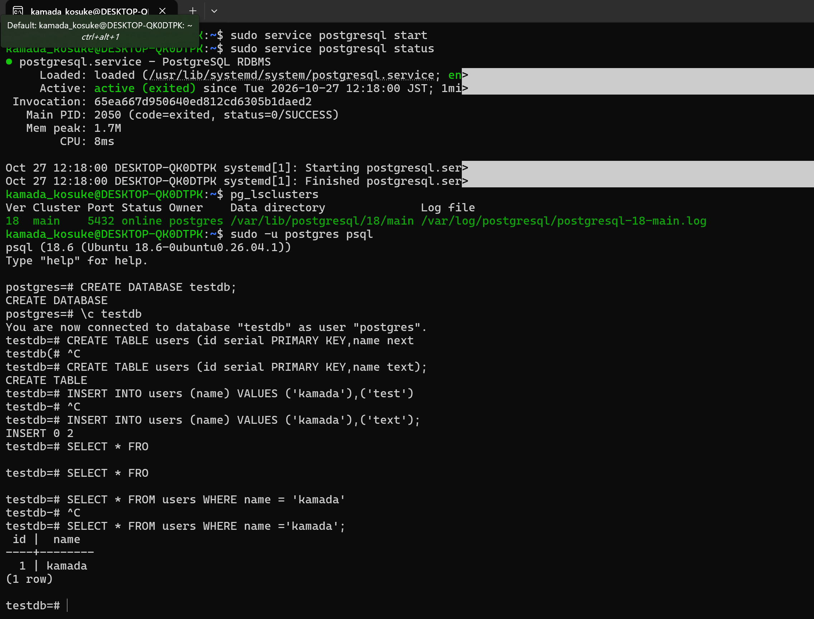

# Linux環境でのWebサーバ・DB構築（WSL / Ubuntu）

## 目的
保守運用の経験をもとに、設計・構築へ進むための学習として、**Linux上にWebサーバとDBが動く環境を自分で構築**し、構築の流れを一通り身につけることを目的としています。
今後は同じ構成を **AWS（EC2・RDS）** でも構築する予定です。

## 環境
| 項目 | 内容 |
|---|---|
| OS | Windows + WSL（Ubuntu） |
| Webサーバ | Apache2 |
| DB | PostgreSQL 18 |

## 構成
```
Windows
 └─ WSL（Ubuntu）
     ├─ Apache2（Webサーバ）… http://localhost で表示
     └─ PostgreSQL 18（DB） … ポート5432で稼働
```

## 手順

### 1. WSL（Ubuntu）の導入
```powershell
wsl --install -d Ubuntu   # WindowsにUbuntuをインストール
```

### 2. Webサーバ（Apache）の構築
```bash
sudo apt update                    # インストールできるソフトの一覧を最新化
sudo apt install -y apache2        # Apacheをインストール
sudo service apache2 start         # Apacheを起動
echo "hello from Kamada" | sudo tee /var/www/html/index.html   # 表示するページを作成
```
ブラウザで `http://localhost` を開き、ページが表示されることを確認しました。


### 3. DB（PostgreSQL）の構築
```bash
sudo apt install -y postgresql     # PostgreSQLをインストール
sudo service postgresql start      # PostgreSQLを起動
pg_lsclusters                      # クラスタの状態を確認（18 main / 5432 / online）
sudo -u postgres psql              # 管理者ユーザーpostgresでDBに接続
```

### 4. DB・テーブルの作成とデータ操作
```sql
CREATE DATABASE testdb;                                   -- DBを作成
\c testdb                                                 -- 作成したDBに接続
CREATE TABLE users (id serial PRIMARY KEY, name text);    -- テーブルを作成（idは自動採番の主キー）
INSERT INTO users (name) VALUES ('kamada'), ('text');     -- データを2行登録
SELECT * FROM users WHERE name = 'kamada';                -- 条件を指定して検索
```



## つまずいた点と対応
| 内容 | 原因 | 対応 |
|---|---|---|
| `Unable to locate package` | パッケージ名を大文字で入力していた | 小文字の `postgresql` で再実行 |
| プロンプトが `testdb(#` / `testdb-#` のまま | カッコや `;` が閉じておらず、命令が途中だった | `Ctrl + C` で取り消し、正しい文で再入力 |

## 学んだこと
- サービスの**導入 → 起動 → 状態確認**という、構築の基本的な流れ
- 前職では**既存のDBを調査する側**（SELECT・WHERE・JOIN）だったが、今回は**DBを一から作る側**を経験
- エラーの文言から原因を切り分ける進め方は、保守運用での**不具合調査と同じ考え方**で対応できた

## 今後の予定
- PostgreSQLのデータをWebページに表示する（WebサーバとDBの連携）
- シェルスクリプトとcronによる**DBバックアップの自動化**
- 同じ構成を**AWS（EC2・RDS）**で構築
- OSS-DB Silver の取得
